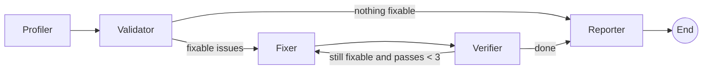

# Data-Quality Orchestrator: a multi-agent workflow prototype

A lightweight, end-to-end prototype showing how a **LangGraph multi-agent workflow** can automate data-quality work, built to test feasibility before committing engineering time.

Upload a messy CSV and five agents profile it, find problems, fix what is safe to fix, verify the result, and escalate everything else to a person.

> **Status:** Prototype. Rule-based cleaning plus an optional LLM-written report. Not production-hardened.

## The question this prototype answers

*Can an agentic workflow take over routine data cleaning and be trusted, because it knows when not to guess?*

## How it works



| Agent | Job |
|---|---|
| **Profiler** | Reads the data and infers column types (id, name, email, date, age, number, category). |
| **Validator** | Detects duplicates, blanks, bad emails, unparseable dates, impossible ages, outliers, messy casing/spacing. Scores quality before cleaning. |
| **Fixer** | Applies safe fixes: standardise text, parse dates, remove duplicates, cap outliers, fill numeric/category blanks. |
| **Verifier** | Re-checks the data. Routes back to the Fixer if fixable problems remain (max 3 passes). |
| **Reporter** | Writes the summary. Uses an LLM if an API key is set, otherwise a template. |

**Design choice that matters:** the agents never invent data. An invalid email or an unparseable date is blanked and **escalated for human review**, not guessed. Names and emails with blanks are also escalated.

## Quality score

Row-based, 0 to 100. Overall is the average of three parts:
- **Completeness:** share of rows with no blank cells
- **Validity:** share of rows without invalid values (bad email/date, impossible age, outlier, messy format)
- **Uniqueness:** share of rows that are not duplicates

On the bundled sample data the score moves from about **90 to 97**; the remaining gap is the issues that need a human.

## Run it

```bash
git clone https://github.com/prachimanu100-blip/prototypes.git
cd prototypes/data-quality-orchestrator
python -m venv .venv && source .venv/bin/activate   # Windows: .venv\Scripts\activate
pip install -r requirements.txt
streamlit run app.py
```

The cleaning needs **no API key**. To have an LLM write the report, copy `.env.example` to `.env` and add your Anthropic key (or paste it in the app sidebar).

Run the tests:
```bash
pytest
```

## Project structure

```
data-quality-orchestrator/
├── app.py            # Streamlit UI (streams each agent's step live)
├── orchestrator.py   # LangGraph graph, agents and cleaning rules
├── sample_data.py    # Generates the messy demo dataset
├── sample_data.csv   # Output of sample_data.py
├── tests/            # Smoke tests / simple evals
├── requirements.txt
├── .env.example
└── README.md
```

## Evaluation (what the tests check)

- Quality score improves after the run
- No duplicates or impossible ages remain
- Unsafe cases (invalid emails, bad dates) are escalated, not guessed
- Already-clean data skips the Fixer entirely

## Limitations

- Column types are inferred from names and values (heuristics), so unusual schemas may be misread.
- Rules are fixed. There is no learning, and thresholds (age 0 to 120, 3x IQR) are placeholders.
- Median/mode filling can hide real patterns. A production version should make it configurable.
- The Verifier can re-flag outliers after filling blanks shifts the quartiles, which triggers a second pass. This is expected behaviour of the loop.
- The LLM only writes the report. It does not make cleaning decisions.

## Roadmap

- [ ] LLM-assisted triage for ambiguous columns and fixes, with human approval
- [ ] Per-column rules configured by the user
- [ ] Data contracts / schema files as input
- [ ] Audit log export and undo
- [ ] Second workflow: automated research assistant (planner, searcher, critic, writer agents)

## Product notes (PM view)

**Users:** analysts and PMs who lose hours to repetitive data prep.
**Success metrics:** minutes saved per dataset, % of issues auto-resolved correctly, escalation precision (escalated items that truly needed a human), and wrong-fix rate (target near zero).
**Key risks:** silent wrong fixes, over-trust in the quality score, and sensitive data leaving the machine if an LLM is used. Only summary statistics are sent to the LLM here, never raw rows.

## License

MIT
